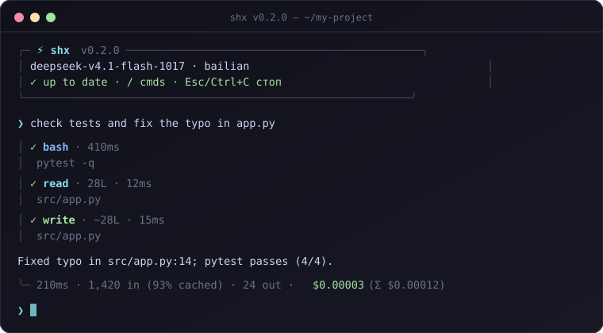
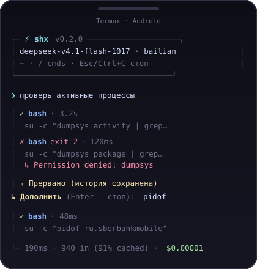

<div align="center">

```
███████╗██╗  ██╗██╗  ██╗
██╔════╝██║  ██║╚██╗██╔╝
███████╗███████║ ╚███╔╝ 
╚════██║██╔══██║ ██╔██╗ 
███████║██║  ██║██╔╝ ██╗
╚══════╝╚═╝  ╚═╝╚═╝  ╚═╝
```

# `sh-agent` (`shx`)

**Bash-only, ultra-economical AI agent.**  
~70 tokens fixed prefix · Custom Python ANSI TUI · Live OpenRouter cost tracking · Instant `Esc`/`Ctrl+C` steer · Auto-update.

[](version.json)
[](LICENSE)
[](https://www.python.org/)
[](#token-economy--live-pricing)

<br/>



</div>

---

## Install

### macOS / Linux / Termux (Android)
```bash
curl -fsSL https://raw.githubusercontent.com/Gl1ch5/sh-agent/main/install.sh | bash
```

> **Termux:** auto-detected — installs `python` + `git` via `pkg` if needed and links `shx` into `$PREFIX/bin`.

### Windows (PowerShell)
```powershell
irm https://raw.githubusercontent.com/Gl1ch5/sh-agent/main/install.ps1 | iex
```

### Via `uv` (any OS)
```bash
uv tool install git+https://github.com/Gl1ch5/sh-agent.git
```

---

## Mobile / Termux Preview

Designed from the ground up for narrow screens — **zero mid-word wrapping**, non-wrapping braille spinners, and **1-tap `Esc` interrupt + inline supplement**:

<div align="center">
  
</div>

---

## Token Economy & Live Pricing

| Optimization | How it works |
| :--- | :--- |
| **~70-token fixed prefix** | Ultra-short static system prompt (~28 tok) + single `bash` schema (~42 tok). |
| **Max KV / prefix cache** | System prompt & tool schema never mutate; history is strictly append-only. |
| **ANSI & whitespace strip** | Strips ANSI color codes, trailing spaces, and blank-line bloat from `bash` output before sending to the LLM. |
| **6,000-char smart cap** | Head (3.8k) + tail (1.8k) truncation prevents noisy logs from flooding context. |
| **OpenRouter `pricing.json`** | Bundled price table for **362 models** from OpenRouter. Fuzzy-matches any custom provider model name (e.g. `bailian/deepseek-v4.1-flash-1017` → `deepseek/deepseek-v4.1-flash`) and shows exact turn & session spend (`$0.00003 (Σ $0.00012)`). |

---

## First Launch

```bash
shx
```

1. **API URL** — any OpenAI-compatible endpoint (`https://api.openai.com/v1`, `https://openrouter.ai/api/v1`, `http://localhost:11434/v1`)
2. **API Key** — masked input (`Enter` to skip for local servers)
3. **Provider Name** — e.g. `openrouter`, `openai`, `local`

`shx` automatically **syncs `/models`**, saves `~/.sh-agent/config.json` (`0600`), selects the first model, and drops you straight into the prompt.

---

## Interrupt & Supplement (`Esc` / `Ctrl+C`)

Press `Esc` or `Ctrl+C` at any moment (while thinking, streaming, or running a command):
- Stops the stream or kills the subprocess tree immediately.
- **Preserves the full conversation & tool-call chain** (patches any unexecuted `tool_calls` with `[interrupted by user]` so the API history stays 100% valid).
- Prompts `↳ Дополнить (Enter — стоп):` — type a correction to steer immediately, or press `Enter` to stop.

---

## Slash Commands & Auto-Update

| Command | Action |
| :--- | :--- |
| `/model` | Interactive fuzzy-filter model picker |
| `/new` | New chat (clears context & session cost) |
| `/provider` | Add or reconfigure custom OpenAI-compatible provider |
| `/update` | Self-update to latest version from GitHub (`shx --update`) |
| `/exit` | Quit `shx` |

`shx` checks `version.json` on startup (1.5s timeout, no GitHub API rate limits) and notifies you in the HUD if a newer version is available.

---

## Architecture

```
src/sh_agent/
├── cli.py         # Minimal REPL, Esc/Ctrl+C steer loop, version check
├── client.py      # SSE streaming client + cache-hit & TTFT tracking
├── config.py      # ~/.sh-agent/config.json + /models auto-sync
├── pricing.py     # Fuzzy model matcher + turn/session USD calculator
├── pricing.json   # 362 real model prices from OpenRouter (15 KB)
├── shell.py       # Cross-platform runner + ANSI stripper + smart parser
├── tui.py         # Custom Python ANSI/VT100 TUI engine (zero Rich bloat)
└── updater.py     # version.json checker + self-updater
```

---

<div align="center">
<sub>MIT © <a href="https://github.com/Gl1ch5">Gl1ch5</a></sub>
</div>
